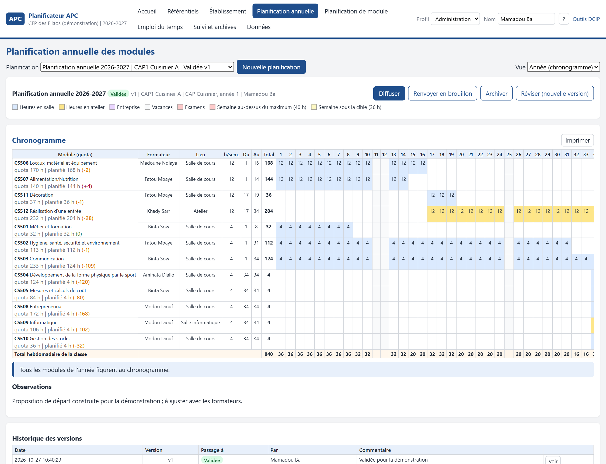
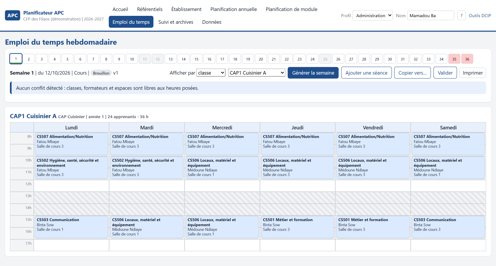

# Le Planificateur APC

Application de planification pédagogique pour les établissements de **formation professionnelle et technique** qui travaillent en **approche par compétences**. Elle sert deux publics avec le même référentiel : **l'enseignant**, qui planifie son module séance par séance ; **l'administration**, qui planifie tous les modules d'une année de formation pour chaque classe, par semaine, par mois et sur l'année, puis décline chaque semaine en **emploi du temps** sous contraintes de formateurs et d'espaces.

Les planifications se rédigent en brouillon, se soumettent, se valident, se diffusent et s'archivent. Chaque version reste consultable. L'emploi du temps se génère, se corrige à la main et dit clairement ce qui ne tient pas et pourquoi.

Conçue au sein de la **Direction des Curricula et des Innovations Pédagogiques (DCIP)**.

> 🟡 **Version 0.1, en essai à la DCIP** depuis octobre 2026, bâtie sur les documents nationaux récents : guides d'organisation matérielle et pédagogique de 2024, référentiels « parcours dualisé » de 2025.

---

## En images

Le chronogramme annuel d'une classe, à la manière du canevas du ministère : un module par ligne, les 36 semaines en colonnes, le quota de chaque module et le total hebdomadaire de la classe contrôlés en continu.

L'emploi du temps d'une semaine pour une classe : chaque séance porte son module, son formateur et son espace. Les conflits, s'il y en a, sont listés au-dessus de la grille.

*Captures produites sur un établissement de démonstration aux données fictives : les classes, les formateurs et les plannings y sont inventés. Toute ressemblance de nom avec une personne réelle serait fortuite.*

---

## Ce qui le caractérise

- **📘 Le référentiel d'abord** : modules, éléments de compétence, objectifs spécifiques et durées sont la matière première de toute planification. Ils s'importent depuis les référentiels nationaux ou se saisissent.
- **🗓️ Le chronogramme des guides nationaux** : compétences particulières et générales en parallèle, 36 à 40 heures par semaine, séjours en entreprise, semaines de vacances et d'examens exclues ; une proposition automatique que l'administration ajuste ligne par ligne.
- **👩‍🏫 Un cadre pour l'enseignant** : son module décliné en séances dans les heures que l'annuelle lui réserve, la couverture de chaque élément de compétence, une fiche de progression imprimable.
- **🧩 Un emploi du temps qui respecte le réel** : jours ouvrés et fériés, pause, charge journalière, indisponibilités et charge maximale des formateurs (vacataires compris), type d'espace requis (salle, atelier, laboratoire, salle informatique) et capacité, jours en entreprise des classes duales. Ce qui ne tient pas est listé avec sa raison.
- **✋ La main reste aux personnes** : correction manuelle, verrouillage d'une séance, copie d'une semaine type, vues par classe, par formateur, par espace.
- **🔏 Une trace à chaque étape** : brouillon, soumise, validée, diffusée, archivée ; une version diffusée ne se modifie plus, elle se révise ; l'ancienne reste lisible.
- **💻 Sur le poste, hors ligne** : aucune installation de serveur, aucune connexion, des exports pour échanger entre postes.

---

## Ce qu'il refuse d'être

Ni un logiciel d'emploi du temps déconnecté des programmes, ni un optimiseur opaque. Le Planificateur part du référentiel et des décisions de l'établissement ; il propose, contrôle et signale. Il ne tranche pas à la place de la direction des études ; il ne cache jamais une séance qu'il n'a pas su placer.

---

## La vérification

| Épreuve | Résultat |
|---|---|
| Référentiels nationaux importés depuis le corpus de la DCIP | deux métiers (cuisine, électricité), 30 modules, 85 éléments de compétence, 281 objectifs |
| Établissement de démonstration | 3 classes dont une duale, 8 formateurs dont 3 vacataires, 8 espaces |
| Première semaine générée | 41 séances placées sur 43, les 2 restantes signalées avec leur cause |
| Cycle de vie | soumission, validation, diffusion, révision et archivage éprouvés |
| Diffusion | application Windows installable sans droits d'administrateur, édition macOS |

---

## Voir la présentation

La page de présentation détaillée est disponible ici : **https://oumarsall3.github.io/planificateur-apc/**

---

## À propos de ce dépôt

Ce dépôt **présente** l'application et les choix qui la fondent. Il ne publie volontairement **ni son code source, ni son installateur, ni aucune donnée** d'établissement. Les captures proviennent d'un établissement de démonstration aux données fictives.

**Conception :** Oumar SALL, Direction des Curricula et des Innovations Pédagogiques, MEFPT, Sénégal.
